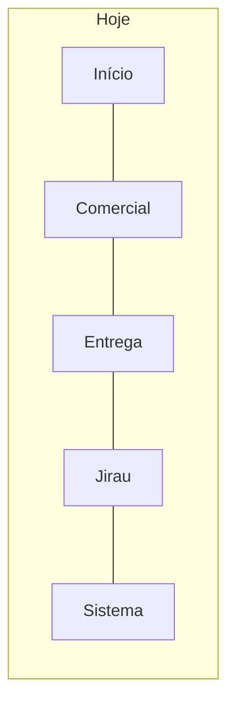
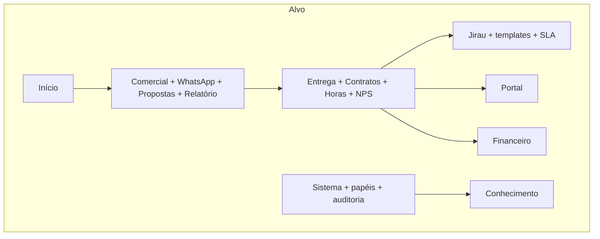
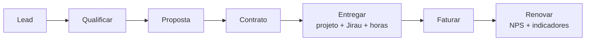

# Roadmap de produto BURI-TI

Ideias de **módulos**, **submódulos** e **recursos** inspirados em concorrentes, com impacto medido sobre o sistema actual (site + CRM + Jirau). A versão visível no admin vem de `config/buriti.php` (`RuntimeVersions`); este ficheiro acompanha o lançamento **1.10 Porto**.

Este ficheiro é o artefacto no Git. A leitura operacional está em **Sistema → Roadmap** (`/admin/sistema/roadmap`). Complementa a consolidação do CRM em [`CRM-CONSOLIDACAO.md`](CRM-CONSOLIDACAO.md).

Não é um compromisso de entrega. É um mapa para não copiar HubSpot inteiro nem ignorar o que Pipedrive, Accelo e o mercado BR já resolveram.

## Entregue no 1.10 Porto

- Compositor com Para, Cc e Cco em chips: busca nos contatos do CRM enquanto se digita; a lista abre fora do painel (não fica cortada).
- Responder uma mensagem do site já chega com o nome e o e-mail do formulário.
- E-mails recebidos e respondidos geram resumo no Telegram e notificação no sistema.
- Textos do correio e do painel em pt-BR.

## Entregue no 1.9 Corrente

- Correio IMAP só para o admin: pastas, leitura, envio, respostas ao site e rascunhos, com a identidade do login SMTP.
- Cópia em Enviados após o SMTP (APPEND exacto; Gmail/Outlook usam a pasta do provedor).
- Assinatura pronta e rodapé de confidencialidade + LGPD (Lei nº 13.709/2018) em cada envio.
- Busca da pasta isolada da busca do painel; apagar o critério restaura a listagem.
- Bot: `/correio`, `/email` e `/mensagem responder` pela mesma conta.

## Entregue no 1.8 Nascente

- 2FA admin: TOTP nas Senhas do iPhone quando vinculado; Telegram como fallback; desafio web no bot continua sem widget.
- Chrome admin: perfil na topbar, barra lateral e superior fixas, atalhos Meet / Teams / Jitsi.
- Telefones em E.164 (DDI + DDD + número) no CRM, no bot e nos links `tel:` / `wa.me`.
- Política de privacidade alinhada ao tratamento real (CRM, Telegram, Google, 2FA).

## Entregue no 1.7 Igarapé

- Sino de notificações ao lado do perfil, caixa persistida (Jirau, site, agenda) e card que fecha.
- Tempo no cartão Jirau (Fazer/Encerrar), histórico admin e extrato de horas na analítica.
- Vários responsáveis e atores no cartão (excepto o demandante).
- Faixa no quadro geral por etapa; Jirau por empresa/contrato; inativos sem acção; apagar quadro vazio.
- Templates de quadro (Moodle, i-Educar, consultoria, site) — já na 1.6, marcados como entregues no catálogo.

## Como o impacto é medido

Cada ideia leva três notas de 1 a 5:

| Nota | Significado |
|---|---|
| **Valor** | Melhora a operação solo/pequena equipa da BURI-TI (não o mercado genérico). |
| **Esforço** | 1 ≈ uma semana · 3 ≈ um mês · 5 ≈ semestre. |
| **Risco** | Chance de partir regras já afinadas (reunião/actividade, CSP, Telegram, papéis). |

**Índice** = `(valor × 20 − risco × 4) ÷ esforço`. Prioridade **alta** ≥ 28, **média** ≥ 18, resto **baixa**.

O índice privilegia ganhos rápidos e pune trabalho que parte o kernel (papéis, ERP, WhatsApp mal unificado).

## Princípio

O BURI-TI é o sistema operativo da consultoria, não uma suíte genérica. Crescer **por dentro** dos cinco módulos (Início, Comercial, Entrega, Jirau, Sistema) antes de abrir módulos novos.

## Ciclo que os concorrentes de agência fecham

Pipedrive pára na venda. Accelo/Scoro fecham proposta → contrato → horas → fatura. O CRM actual pára em **Projeto + Agenda**.

As caixas a partir de **Proposta** são as ideias deste documento. Lead e Qualificar já existem (mensagem → contacto → oportunidade).

## O que copiar (e o que não)

| Produto | Tipo | Vale copiar | Não copiar |
|---|---|---|---|
| Pipedrive | CRM vendas | Quotes, actividades com prazo, automações curtas | Marketplace de apps |
| HubSpot | CRM + inbound | Relatório de conversão, sequências de follow-up | Marketing automation, landing pages |
| RD Station / Agendor | CRM BR | WhatsApp na ficha, mobile | Scoring inbound pesado |
| Jira / Linear | Entrega | WIP, SLA, ciclos | Issue tracker genérico a substituir o Jirau |
| ClickUp / Monday | Work OS | Templates de quadro | Tudo-em-um (docs, chat, metas) |
| Accelo / Scoro | PSA agência | Proposta → horas → fatura, portal | PSA enterprise |
| Take Blip / Z-API | WhatsApp | Inbox ligada ao contacto | Chatbot de marketing |
| Odoo / Conta Azul | Financeiro | Contas a receber leve | ERP / NF-e na primeira fatia |
| Moodle / i-Educar | Clientes | Indicadores do produto entregue | Virar LMS |

## Ondas

| Onda | Horizonte | Ideias | Meta |
|---|---|---|---|
| **Agora** | 1–2 meses | Relatório, templates Jirau, SLA de follow-up, auditoria visível, propostas, inbox WhatsApp | Fechar o loop com o funil que já existe |
| **Próximo** | trimestre | NPS, playbooks, contratos, apontamento, SLA Jirau, papéis | Schema novo ainda dentro dos módulos actuais |
| **Escala** | depois | Portal, indicadores educacionais, financeiro, conhecimento | Módulos novos só com papéis + propostas + horas |

## Ideias

### Agora

**Relatório de conversão** — submódulo Comercial · valor 4 · esforço M · risco 1 · índice **38**
Página de leitura sobre o `FunnelMetricsService` (win rate, tempo em estágio, origem). Sem schema. Impacto: queries + menu. Não mexe nas regras de reunião.

**Templates de quadro Jirau** — recurso Jirau · **entregue (1.6)** · valor 4 · esforço M · risco 1 · índice **38**
Clonar colunas/checklists a partir de um modelo Moodle, i-Educar, consultoria ou site Laravel.

**Inbox in-app** — recurso Sistema · **entregue (1.7)** · valor 4 · esforço M · risco 1 · índice **38**
Sino ao lado do perfil, caixa persistida, lidas. Telegram continua.

**SLA de follow-up** — recurso Comercial · valor 4 · esforço M · risco 2 · índice **36**
Prazo máximo sem próxima acção por estágio. O job Telegram já existe. Impacto: settings; **não** auto-concluir actividade.

**Auditoria visível** — submódulo Sistema · valor 3 · esforço M · risco 1 · índice **28**
UI sobre `audit_logs`. Impacto: controller + busca. Zero schema.

**Propostas / orçamentos** — submódulo Comercial · valor 5 · esforço L · risco 2 · índice **31**
Versões + PDF + pasta Drive na oportunidade. Impacto: tabela `quotes`, PDF autenticado, item na nav Comercial. Não substitui contrato.

**Inbox WhatsApp** — submódulo Comercial · valor 5 · esforço L · risco 3 · índice **29**
Webhook na ficha do contacto (campo `whatsapp` já existe). Sem chatbot. Impacto: canal novo, CSP, idempotência, LGPD, risco de duplicar o inbox com site/Telegram.

### Próximo trimestre

**NPS pós-entrega** — recurso Entrega · valor 3 · esforço M · risco 1 · índice **28**
Token no projeto concluído, formulário público mínimo.

**Playbooks** — recurso Comercial · valor 4 · esforço L · risco 3 · índice **23**
Receita curta “lead → tarefa 24h → Telegram”. Risco: ruído no bot e conclusão implícita (proibido pela consolidação do CRM).

**Contratos assistidos** — submódulo Entrega · valor 4 · esforço L · risco 3 · índice **23**
Modelo Drive + revisão humana. Continuação da secção 3.1 de [`CRM-CONSOLIDACAO.md`](CRM-CONSOLIDACAO.md).

**Apontamento de horas** — submódulo Entrega · **parcial (1.7)** · valor 4 · esforço L · risco 2 · índice **24**
Fazer/Encerrar no cartão e extrato na analítica já existem. Falta apontamento na ficha do projeto (base de fatura).

**SLA e WIP no Jirau** — recurso Jirau · valor 4 · esforço L · risco 2 · índice **24**
Limite WIP + aging. Watchers de coluna já existem.

**Papéis além de admin** — recurso Sistema · valor 5 · esforço XL · risco 3 · índice **22**
Comercial / entrega / leitura. Maior blast radius (policies, nav, Telegram, testes). Obrigatório antes de Portal ou Financeiro.

### Escala

**Portal do cliente** — módulo novo · valor 5 · esforço XL · risco 3 · índice **22**
Login do contacto: status, ficheiros, reuniões. Novo guard. Site deixa de ser o único público.

**Indicadores Moodle / i-Educar** — módulo (ou submódulo de Entrega) · valor 5 · esforço XL · risco 3 · índice **22**
Diferenciação que HubSpot não tem. Credenciais por empresa + LGPD.

**Financeiro leve** — módulo novo · valor 4 · esforço XXL · risco 4 · índice **13**
A receber a partir de proposta e horas. Sem NF-e na v1. Só depois de propostas + apontamento + papéis.

**Base de conhecimento** — módulo novo · valor 3 · esforço XL · risco 2 · índice **13**
Playbooks internos. Até o Portal precisar disto, o Notion em Integrações chega.

## Como cada onda mexe no sistema

| Superfície | Agora | Próximo | Escala |
|---|---|---|---|
| **Navegação admin** | Item Sistema (esta leitura) e, no máximo, relatório no Comercial | Submódulos nos quatro módulos de operação | Três módulos novos na barra; rail colapsado e busca precisam de atalhos |
| **Schema** | Quase nenhum | `quotes`, `time_entries`, papéis, contratos, `nps_responses` | `invoices`, `portal_users`, artigos, credenciais Moodle |
| **Jobs / Telegram / Google** | Follow-up já existe | Playbooks geram ruído; contratos pedem Drive | Webhooks WhatsApp e Moodle |
| **Site público** | Intacto | Formulário NPS por token | Portal autenticado; privacidade se houver WhatsApp |
| **Testes** | Leitura + Pint | Policies em todo o admin; não regressar regras de reunião | Dois públicos (staff vs cliente); CSP e 2FA |

### Efeito colateral se as ondas se atropelarem

- Financeiro **antes** de horas e propostas vira cadastro morto.
- Portal **antes** de papéis vaza anexos.
- WhatsApp **sem** unificar threads duplica Mensagens.
- Playbooks **sem** a regra “conclusão explícita” desfaz o trabalho de 2026 no CRM.

## Fora de escopo (de propósito)

- Virar HubSpot (inbound, landing pages, e-mail em massa).
- Virar ClickUp (docs, chat, metas no mesmo sítio).
- ERP completo (estoque, folha, fiscal nativo) antes de proposta e apontamento.
- Chatbot de WhatsApp para marketing.
- Multi-empresa / white-label. O produto é a operação da BURI-TI.

## Relação com a consolidação do CRM

A consolidação de 2026 fechou P0–P2 do funil (empresa canónica, inbox, follow-up, funil, Drive). O que ficou futuro lá — **contratos assistidos** — entra aqui na onda Próximo. Não reabrir P0.

Quando uma ideia deste mapa for feita, actualizar o catálogo em `ProductRoadmap` (status + shipped_in). A página admin e os indicadores de versão lêem `RuntimeVersions` — não duplicar o número da versão à mão no Blade.
